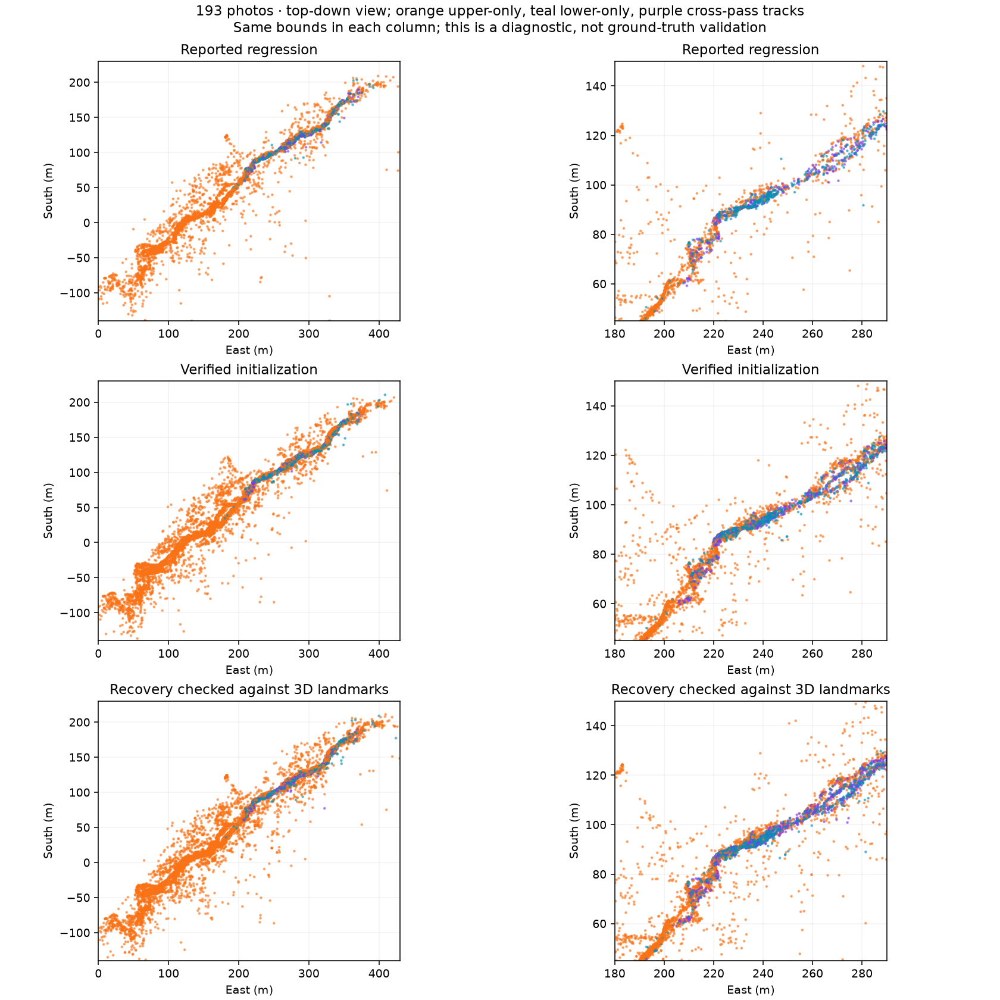

# Cliff alignment regression, 13 November 2026

The 193-photo cliff dataset exposed two independent errors. Descriptor candidates reached rotation refinement, triangulation and camera registration before geometric verification. The subsequent guided pass treated a larger pair-match count as success, rebuilt the track graph, and discarded almost half the established observations. Neither behavior is an acceptable indication of improved reconstruction.

## Corrections

- Verify every automatic pair before it reaches initialization, including legacy saved matches. Explicit manual ties remain explicit user constraints; they are not labeled as geometrically verified.
- Persist pair-verification decisions with new matching artifacts. The native viewer keeps all candidates visible, marks rejected points grey, and identifies rejected/unverified links in the selected-match details. Line candidates remain excluded from the alignment solver. Older artifacts are labeled unverified rather than silently treated as accepted.
- For multi-camera runs, do not publish the unvalidated pairwise cloud. Bundle previews require at least three observations within the reprojection threshold.
- Validate guided additions against existing 3D landmarks at either endpoint and the refined camera geometry. A false correspondence on the correct epipolar line can still fail this independent check.
- Evaluate the proposed second-pass scene before publishing it. It must retain at least 95% of established observation identities and expand total multi-view support. Otherwise retain the initial verified alignment and record an explicit warning and assessment in `recovery.json`. A failed geometric solve also retains the initial alignment; cancellation still propagates.
- Normalize each 3×3 point Hessian before testing its determinant. The old absolute cutoff incorrectly rejected small but invertible damped blocks. Tests cover matrix scales from 1e-12 to 1e12 and singular inputs.

The source changes retain the native macOS shell, use MEF services, and change matching/alignment fingerprints. Existing user runs and artifacts were not overwritten.

## Reproduction and observations

Read-only replay used saved feature and matching artifacts from run `3fbd4a7744164def8414fbd813f0a8d7` (193 photographs, 1,711 selected image pairs, 1000-pixel analysis width, 800 features per photo). Outputs were written under the repository's ignored `local-results` directory.

The user-selected point correspondence 95 in `0512` ↔ `0491` was rejected by fundamental-matrix verification: 86 of 110 point candidates passed. It could nevertheless influence the old initializer because that check ran too late. Correspondence 114 was a descriptor-only line candidate, never an accepted 3D line.

| Pass | Tracks | Observations | Median residual at 1000 px |
| --- | ---: | ---: | ---: |
| Reported guided regression | 5,694 | 33,171 | 0.667 |
| Verified initialization | 10,968 | 60,862 | 0.550 |
| Guided recovery checked against existing 3D | 12,236 | 79,645 | 0.656 |

The corrected recovery retained 59,326 of 60,862 established observations (97.48%). Residuals across these rows are **not** measurements on an identical population: the final row contains more observations. The residual increased relative to initialization; it is not evidence of increased physical accuracy. The support gate prevents the reproduced destructive update, but is not a complete reconstruction-quality certificate.



The plotted limits are identical within each column. Purple points connect upper/lower passes; orange and teal have support from only one of those groups. These views show the saved reconstruction rather than arbitrary point removal. They do not establish that every floating surface has been eliminated. Remaining concerns include repeated cliff texture, poorly conditioned tracks, uncalibrated lens distortion, and the lack of independent surveyed/model ground truth. The pipeline must not describe this output as survey validated.

Replay command (writes only OUTPUT_DIRECTORY):

```sh
dotnet run --project tools/Echo.Benchmarks -c Release -- align PROJECT RUN OUTPUT_DIRECTORY
```

The `verify-pair` benchmark records individual decisions for an image pair. The `cross-pass` benchmark measures feature extraction and independently fitted pair geometry on selected upper/lower photographs. Synthetic tests additionally check known scale/rotation correspondences, low-overlap RANSAC, rejection of on-line descriptor aliases using 3D landmarks, and that rejected matches cannot change the first camera estimate or cloud.
